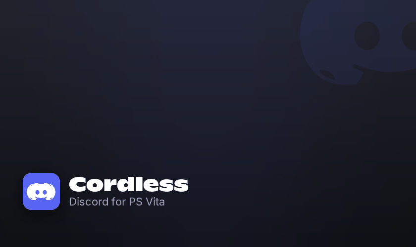

# Cordless



A native homebrew Discord client for the PlayStation Vita. It talks straight to
Discord's REST API and gateway over TLS, with no bridge server and nothing
self-hosted. Every network call runs on a vendored mbedTLS stack over raw
`SceNet` sockets.

> Cordless drives a personal Discord user token (a self-client), so it breaks
> Discord's Terms of Service. It's for personal use, not automation. It isn't
> affiliated with or endorsed by Discord or Sony, and you run it at your own risk.

## Features

- **Chat & social:** Servers, DMs, group DMs, and threads. Send, edit, reply,
  react, and forward messages, with older history loading as you scroll up.
  Renders images, GIFs, and WebP, and plays back video and voice messages.
  Includes Twemoji, live presence, typing indicators, friends, profile popouts,
  mentions, invite joins, blocking, multiple accounts, and permission-gated
  channel visibility and moderation.
- **Voice & DAVE E2EE:** Voice channels and DM/Group DM calls use Opus audio
  with Discord's DAVE (MLS) end-to-end encryption (`VOICE_JOIN_ENABLE=ON`,
  `VOICE_DAVE_ENABLE=ON`), tested on real Vita hardware.
- **Background voice + in-game overlay (optional plugins):** Keep your voice
  call running in `SceShell` while launching or playing any game, and toggle an
  interactive in-game overlay with **`L + R + TRIANGLE`** to see who is speaking
  or **Mute / Deafen / Disconnect** without leaving your game.
- **Controls:** Navigate with D-Pad / Cross, press **`CIRCLE`** to close any
  modal or fullscreen media viewer, and **`SELECT`** / **`START`** in-app to
  mute or leave an active call.

## How Background Voice & In-Game Overlay Work

Normally, launching a game on PS Vita terminates the previous application (`cordless.vpk`).
To keep Discord voice alive across games without bloating game RAM, the optional
plugin suite under `plugin/` splits responsibilities across four modules:

| Binary | taiHEN scope | Role |
|---|---|---|
| `cordless_mem.skprx` | `*KERNEL` | Allocates a 3 MB `USER_SHARED_MAIN_RW` pool for the voice engine and provides tiny kernel syscalls as a fast, socket-free mailbox between `SceShell` and games. |
| `cordless_voice_poc.suprx` | `*main` (`SceShell`) | Minimal (`~7.5 KB`, `-nostdlib`) boot-safe loader. Waits 3s for `SceShell` to finish booting, loads `SCE_SYSMODULE_NET`, dynamically resolves `SceNet` via `taiGetModuleExportFunc`, and listens on `127.0.0.1:47322`. |
| `cordless_voice_core.suprx` | Loaded on demand into `*main` | Full background voice engine (`~1.1 MB`): mbedTLS/Discord Gateway keepalive (`main_gw.c`), voice WebSocket, UDP RTP, Opus, DAVE/MLS E2EE, and a JSON-over-TCP IPC server on `127.0.0.1:47321`. |
| `cordless_hud.suprx` | `*ALL` (games & apps) | Lightweight (`~9 KB`) overlay injected into games. Hooks `sceDisplaySetFrameBuf` and `SceCtrl` to draw the status pill and `L + R + TRIANGLE` control panel. |

### Why four files?

1. **Kernel vs. user (`*KERNEL` vs. `.suprx`):** `cordless_mem.skprx` runs in kernel space to allocate `USER_SHARED_MAIN_RW` memory inside `SceShell` and pass overlay state/actions across isolated processes (`SceShell` ↔ active game) via syscalls.
2. **Keeping games safe (`*main` vs. `*ALL`):** Only the ~9 KB `cordless_hud.suprx` runs in `*ALL`. The 1.1 MB voice/TLS/Opus/MLS engine lives in `SceShell` (`*main`), so games don't lose scarce user RAM.
3. **Boot safety & zero idle overhead (`poc` vs. `core`):** At `t = 0` in `SceShell`, `SceNet` isn't loaded yet, so linking `SceNet_stub` or `libc`/`libstdc++` directly into a `*main` plugin crashes or hangs boot. Splitting the tiny `poc` loader lets the Vita boot cleanly with ~0 KB voice overhead until Cordless is actually opened.

### Lifecycle

1. **On-demand auto-load:** When `cordless.vpk` checks `127.0.0.1:47321` and gets no reply, `voice_ipc.c` knocks on `127.0.0.1:47322`. `cordless_voice_poc.suprx` loads `ur0:tai/cordless_voice_core.suprx` into `SceShell` and replies `"ok"`. (You can also force-reload `core` anytime with **`L + R + START`**.)
   - If the plugins aren't installed, `ECONNREFUSED` returns in `< 1 ms` and `cordless.vpk` runs voice in-process as a standalone app.
2. **Joining & leaving the app:** Joining a channel sends the voice credentials and token over `127.0.0.1:47321` to `cordless_voice_core.suprx`. When you press the PS button and open a game, `cordless.vpk` exits, while `cordless_voice_core.suprx` keeps the Gateway heartbeat, Voice WebSocket, UDP audio, and DAVE session alive in `SceShell`.
3. **In-game HUD (`L + R + TRIANGLE`):** `cordless_voice_core.suprx` pushes channel name, connection state, mute/deafen flags, and active speaker roster into `cordless_mem.skprx`. Inside a game, `cordless_hud.suprx` draws a small status pill (`LIVE` / `MUTED` / `DEAF`) and opens the interactive panel on `L + R + TRIANGLE` (masking controller input from the game while the panel is open so D-Pad + Cross toggle Mute, Deafen, or Disconnect cleanly).

## Build

```bash
bash scripts/build.sh
```

That drops `cordless.vpk` in the repo root. You'll need
[VitaSDK](https://vitasdk.org/) installed at `/usr/local/vitasdk` (Linux/WSL),
`$HOME/vitasdk` (macOS), or pointed to by `VITASDK`. mbedTLS and mlspp come
pre-vendored under `third_party/`, so you only rebuild them with
`scripts/build_tls.sh` or `scripts/build_dave.sh` if you modify them.

Optional CMake flags for `cordless.vpk`: `-DCORDLESS_INSECURE_TLS=ON` skips TLS
hostname matching for Vita3K, `-DCLIENT_BUILD_NUMBER=<n>` sets the build number
Cordless advertises, and `-DVOICE_JOIN_ENABLE=OFF` / `-DVOICE_DAVE_ENABLE=OFF`
disable voice or DAVE E2EE.

### Building the background plugins

Build the kernel helper, loader, and HUD overlay:

```bash
bash scripts/build_plugin.sh
```

To build the full voice core (`cordless_voice_full.suprx`, which is deployed as
`ur0:tai/cordless_voice_core.suprx`), configure `plugin/` with `-DBUILD_VOICE_FULL=ON`
(note `scripts/build_plugin.sh` writes an 8 KB stub `cordless_voice_core.suprx`
for loader testing):

```bash
cmake -S plugin -B /tmp/cordless_full_plugin_build \
  -DCMAKE_TOOLCHAIN_FILE="$VITASDK/share/vita.toolchain.cmake" \
  -DBUILD_VOICE_FULL=ON
cmake --build /tmp/cordless_full_plugin_build --target cordless_voice_full.suprx-self -j4
```

## Install and run

1. Install `cordless.vpk` in VitaShell on a Vita running HENkaku (firmware 3.60 to
   3.74). Launch it and sign in with a token or a QR code; both are covered in
   [docs/login.md](docs/login.md).
2. *(Optional, for background voice + in-game overlay)* Copy all four plugin
   files (`cordless_mem.skprx`, `cordless_voice_poc.suprx`,
   `cordless_voice_core.suprx`, `cordless_hud.suprx`) to `ur0:tai/`, add these
   three entries to `ur0:tai/config.txt` (`cordless_voice_core.suprx` is loaded
   automatically by `poc`, not listed in `config.txt`), and reboot:

   ```ini
   *KERNEL
   ur0:tai/cordless_mem.skprx

   *main
   ur0:tai/cordless_voice_poc.suprx

   *ALL
   ur0:tai/cordless_hud.suprx
   ```

Logs land at `ux0:data/cordless/log.txt` (app), `ur0:data/cordless_voice_poc.log`
(loader), `ur0:data/cordless_voice_full.log` (background core), and
`ur0:data/cordless_hud.log` (HUD).

## Licenses

This project is MIT; see [LICENSE](LICENSE). Everything vendored keeps its own
license: mbedTLS (Apache-2.0), mlspp (BSD-2, (c) Cisco), jsmn (MIT), stb_image
(public domain), QR-Code-generator (MIT, (c) Nayuki), the Inter font (OFL 1.1),
Twemoji artwork (CC-BY 4.0), and the Mozilla CA bundle (MPL-2.0). The photo and
camera dialog layouts are adapted from LifeLua.

Disclosure: AI was used for API research and live area assets.
